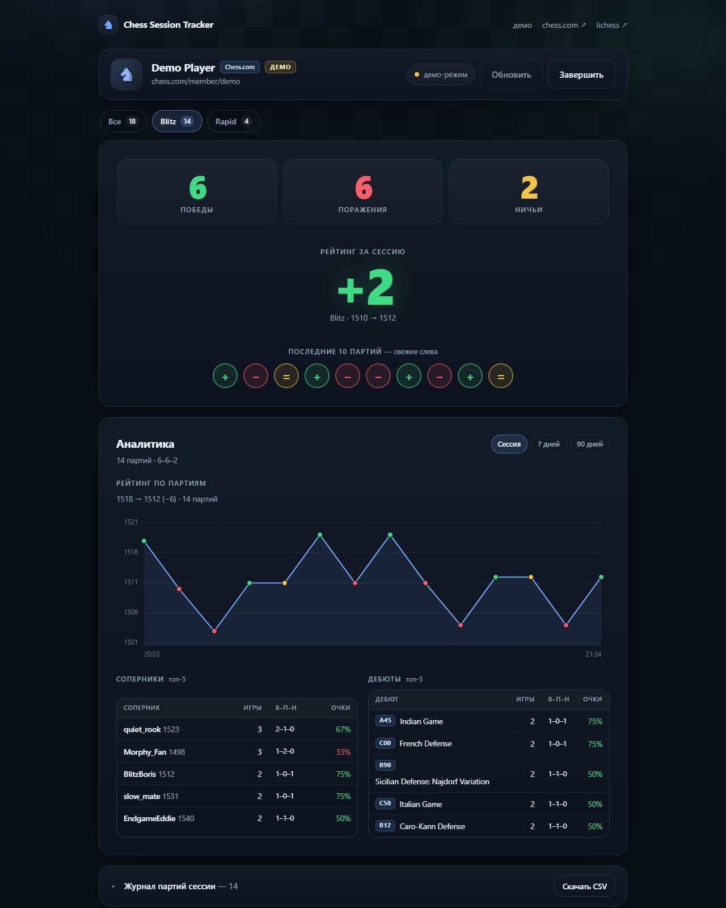

# Chess Session Tracker

Считает статистику игровой сессии на **Chess.com** и **Lichess**: победы, поражения, ничьи,
изменение рейтинга, последние 10 партий иконками. В аналитике — график рейтинга, топ соперников и
дебютов, точность, серии и ещё несколько срезов.

**Сайт:** https://oobatrakov.github.io/chess-session-tracker/
**Демо:** https://oobatrakov.github.io/chess-session-tracker/?demo=1

## Возможности

* **Две площадки**: Chess.com и Lichess с переключателем. Если ник не найден на выбранной —
приложение попробует вторую и сообщит об этом.
* **Три контроля**: Bullet, Blitz и Rapid. Daily и Classical в статистику не попадают.
* **Сессия**: считаются партии, завершённые после нажатия «Начать сессию»; всё, что было до этого,
остаётся базовой линией.
* **Основные показатели**: победы / поражения / ничьи, изменение рейтинга по каждому контролю,
последние 10 партий с цветовой индикацией.
* **Главный виджет**: изменение рейтинга по центру, вокруг — винрейт, средняя точность за сессию,
текущая серия и круговые диаграммы результата за белых и чёрных (в центре — кони).
* **Последние 10 партий**: самая свежая — справа, крупнее и с подсветкой; на телефоне — отдельной
центрированной строкой. Цвет фигур показан небольшим кружком в правой части значка.
* **Сброс сессии** без выхода: отсчёт начинается заново, а загруженная история остаётся для графиков
и периодов «7 дней / 90 дней».
* **Аналитика за период** «Сессия / 7 дней / 90 дней» и по контролю времени.
* **График рейтинга**: точки на равных интервалах по номеру партии (паузы между днями не растягивают
график), точки окрашены по результату; при фильтре «Все» — линия на каждый контроль с легендой.
* **Интерактивный график**: при наведении на точку — рейтинг, результат, цвет, соперник, дата и Δ;
на телефоне — по тапу. Подсветка точки и тултип работают и в графике за год.
* **Топ-5 соперников** с сортировкой по рейтингу или по проценту очков.
* **Топ-5 дебютов**: код ECO, название, результат.
* **Точность**: средняя, отдельно в победах и поражениях (там, где площадка её отдаёт).
* **Цвет**: результат за белых и за чёрных.
* **Серии**: текущая, лучшая серия побед и самая длинная серия без поражений.
* **Время суток**: в какое время результат лучше.
* **Рейтинг за год**: отдельный график по месяцам по кнопке (кешируется на сутки).
* **Live-статус**: для Lichess и daily-партий Chess.com — видно в шапке.
* **Журнал партий** с рейтингом и изменением рейтинга по каждой игре.
* **Цитата** на стартовом экране и **совет** по итогам периода — по данным ваших партий.

## Как это работает

* Данные берутся из публичных API Chess.com (`/pub/player/...`) и Lichess (`/api/user/...`,
`/api/games/user/...`). Ключи не нужны, CORS открыт, прокси отсутствует — сайт полностью статический.
* При старте загружается история за 90 дней плюс запас 45 дней, чтобы у графика и статистики был
контекст и корректные дельты рейтинга.
* Дальше — опрос раз в 30 секунд: только свежие партии, дубли отсекаются по id.
* Сессия хранится в `localStorage` браузера и переживает перезагрузку страницы.

## Что и как считается

|Показатель|Правило|
|-|-|
|Партии сессии|Завершились после нажатия «Начать сессию»; после «Сбросить» — после момента сброса, история при этом сохраняется|
|Победа / поражение / ничья|По результату игрока (Chess.com: `win` и ничейные статусы; Lichess: `winner` и `status`)|
|Рейтинг|Отдельно по каждому контролю. Для сессии якорь — рейтинг на старте (или на момент сброса); для периода 7/90 дней — рейтинг перед первой партией окна|
|Δ по партии|Lichess отдаёт точный `ratingDiff`; для Chess.com считается по последовательности рейтингов|
|Винрейт|Победы / все партии сессии; ничьи входят в знаменатель|
|Последние 10|Свежая справа, крупнее и с подсветкой; зелёный `+`, жёлтый `=`, красный `−`; цвет фигур — кружком в правой части|
|Точность|Chess.com: поле `accuracies` (есть в большинстве партий); Lichess: только в разобранных партиях. В главном виджете — средняя за сессию|
|Серия|Текущая серия подряд, лучшая серия побед и самая длинная серия без поражений|
|Цвет|Результат за белых и чёрных; в главном виджете — донаты с конями, доли побед/ничьих/поражений и процент очков|
|Дебюты|Chess.com: `ECO` и `ECOUrl` из PGN; Lichess: поле `opening`|
|Рейтинг за год|Последний рейтинг каждого месяца, отдельно по контролям|

Учитываются только классические шахматы (`rules: "chess"` у Chess.com, `variant: "standard"` у Lichess)
и только Bullet / Blitz / Rapid. Варианты и Daily/Classical имеют отдельные рейтинги и в статистику
не входят.

## Ограничения

* Партии до старта сессии (или до нажатия «Сбросить») не учитываются — это by design.
* Партия появляется только после завершения.
* API может отдавать данные с задержкой в несколько секунд.
* Daily-партии на Chess.com и correspondence на Lichess не учитываются.
* Chess.com не отдаёт публично текущие live-партии: live-статус доступен для Lichess и для daily-партий
Chess.com (там показывается «ваш ход» без имени соперника).
* Точность на Lichess есть только у разобранных партий, поэтому блок может быть пустым.
* Статистика живёт в браузере: другая машина или очистка данных сайта = пустая сессия.
* У API есть лимиты: при 429 приложение покажет сообщение и продолжит опрос.

