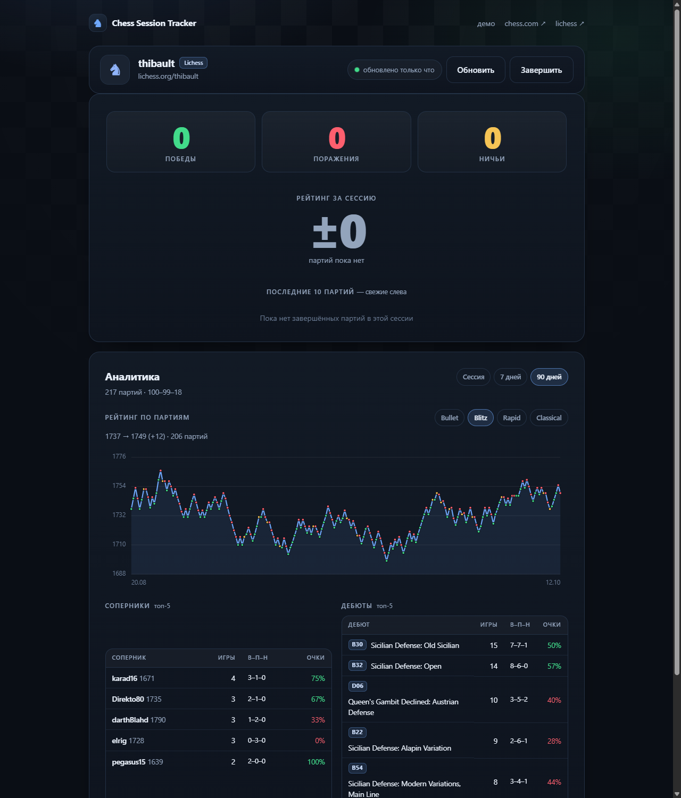

# Chess Session Tracker

Веб-приложение считает статистику игровой сессии на **Chess.com** и **Lichess**: победы, поражения,
ничьи, изменение рейтинга, последние 10 партий иконками. В аналитике — график рейтинга по партиям,
топ соперников и топ дебютов.




## Сайт в интернете

Опубликованная версия (GitHub Pages): **https://oobatrakov.github.io/chess-session-tracker/**

Демо без входа: `https://oobatrakov.github.io/chess-session-tracker/?demo=1`

Локальный запуск — в разделе [Запуск](#запуск).

## Возможности

- **Две площадки**: Chess.com и Lichess, переключатель на стартовом экране. Если ник не найден на
  выбранной площадке, приложение автоматически попробует вторую и сообщит об этом.
- **Сессия**: считаются партии, завершённые после нажатия «Начать сессию»; до этого момента —
  базовая линия, чтобы старые партии не попадали в статистику.
- **Показатели**: победы, поражения, ничьи; изменение рейтинга по каждому контролю времени
  (Bullet / Blitz / Rapid / Classical / Daily); последние 10 партий с цветовой индикацией результата.
- **Аналитика за период**: «Сессия» / «7 дней» / «90 дней».
- **График рейтинга** по партиям с точками результатов и подсказками при наведении, отдельный
  переключатель контроля (Bullet / Blitz / Rapid / …).
- **Топ-5 соперников**: игры, В–П–Н, процент очков, средний рейтинг соперника.
- **Топ-5 дебютов**: код ECO, название, игры, В–П–Н, процент очков.
- **Журнал партий** с экспортом в CSV.
- Сессия хранится в браузере (`localStorage`) и переживает перезагрузку страницы.

## Запуск

Приложение состоит из статических файлов, но браузер не разрешает загружать JS-модули прямо с диска
(`file://`), поэтому файлы отдаёт крошечный локальный сервер на Node.js. Внешних зависимостей нет.

**Проще всего — двойной щелчок по `Запустить приложение.cmd`.**

Откроется консольное окно и браузер с адресом <http://127.0.0.1:5173>.
Пока окно открыто — сервер работает; закрыли окно (или нажали Ctrl+C) — сервер остановился.
Статистика сессии при этом не теряется: она хранится в браузере.

**Через терминал:**

```bash
node serve.mjs
# или: npm start
```

**Нужен ли Node.js.** `.cmd` сначала ищет Node в системе, затем встроенную копию, которую
использует сам DSH. Если не нашёл — предложит установить LTS-версию с <https://nodejs.org>.

**Если порт занят** — сервер сообщит об этом; можно запустить на другом порту:
`set PORT=5174` перед запуском.

## Публикация на GitHub Pages

Репозиторий: `oobatrakov/chess-session-tracker` (публичный, бесплатный план). Git и `gh` на машине
не требуются — всё делается через сайт GitHub.

1. Откройте <https://github.com/new>.
2. Repository name: `chess-session-tracker`. Visibility: **Public**. Нажмите **Create repository**.
3. На странице репозитория: **Add file → Upload files**.
4. Перетащите **содержимое** папки `E:\deep` (не саму папку): `index.html`, папку `assets`, `README.md`,
   `ref.png`, `docs`, `tests`, `scripts`, `serve.mjs`, `package.json`. Нажмите **Commit changes**.
5. Создайте файл `.nojekyll`: **Add file → Create new file**, имя `.nojekyll`, содержимое — любое
   (например, `static`), **Commit changes**. Файл отключает обработку Jekyll и ускоряет публикацию.
   Если при перетаскивании папки `.nojekyll` уже попал в репозиторий — пропустите этот шаг.
6. **Settings → Pages**: Source — **Deploy from a branch**, Branch — **main**, папка — **/ (root)**,
   **Save**.
7. Через 1–2 минуты сайт будет доступен: <https://oobatrakov.github.io/chess-session-tracker/>.

**Как обновлять сайт:** загружайте изменённые файлы через **Add file → Upload files** (они заменят
старые) и коммитьте. Pages пересоберётся автоматически.

**Проверка после публикации:** откройте сайт, нажмите «демо» и начните тестовую сессию — если
график и таблицы отрисовались, всё на месте.

## Что и как считается

| Показатель | Правило |
| --- | --- |
| Партии сессии | Завершились после нажатия «Начать сессию» |
| Победа / поражение / ничья | По результату игрока (Chess.com: `win` и ничейные статусы; Lichess: `winner` и `status`) |
| Рейтинг | Отдельно по каждому контролю. Для сессии якорь — рейтинг на старте; для периода 7/90 дней — рейтинг перед первой партией окна |
| Δ по партии | Lichess отдаёт точный `ratingDiff`; для Chess.com считается по последовательности рейтингов |
| Последние 10 | Свежие слева; зелёный `+`, жёлтый `=`, красный `−` |
| Соперники и дебюты | За выбранный период и выбранный контроль; топ-5 по числу партий |
| Дебюты | Chess.com: `ECO` и `ECOUrl` из PGN; Lichess: поле `opening` (`eco`, `name`) |

Учитываются только классические шахматы (`rules: "chess"` у Chess.com, `variant: "standard"` у Lichess):
варианты имеют отдельные рейтинги. Lichess `correspondence` считается как Daily, `ultraBullet` — как Bullet.

## Как это работает

- Публичные API: Chess.com (`/pub/player/...`) и Lichess (`/api/user/...`, `/api/games/user/...`).
  Ключи не нужны, CORS открыт, прокси отсутствует.
- При старте загружается история за 90 дней плюс запас 45 дней — чтобы у графика и статистики был
  контекст и корректные дельты рейтинга.
- Опрос — раз в 30 секунд, только свежие партии (последние 3 дня, дубли отсекаются по id).
- Обновление сразу при возврате на вкладку.

## Ограничения

- Партии до старта сессии не учитываются — это by design.
- Партия появляется только после завершения.
- API может отдавать данные с задержкой в несколько секунд.
- Daily-партии на Chess.com и correspondence на Lichess могут завершиться через дни.
- Статистика живёт в браузере: другая машина или очистка данных сайта = пустая сессия.
- У обоих API есть лимиты: при 429 приложение покажет сообщение и продолжит опрос.

## Структура

```
Запустить приложение.cmd  запуск двойным щелчком (сервер + браузер)
index.html                разметка
assets/styles.css         оформление (тёмная тема, адаптив)
assets/app.js             состояние, опрос API, отрисовка
assets/session.js         логика: формат партии, сводки, агрегаты, CSV
assets/chart.js           SVG-график рейтинга
assets/http.js            HTTP-слой и ошибки
assets/providers/         chesscom.js, lichess.js, index.js
assets/demo.js            демо-данные
serve.mjs                 статический сервер без зависимостей
scripts/smoke.mjs         диагностика на живых данных
tests/session.test.mjs    тесты
.nojekyll                 для GitHub Pages
```

## Тесты

```bash
npm test
# эквивалент: node --test --test-isolation=none "tests/*.test.mjs"
```

26 тестов: разбор результатов, история рейтинга, периоды, фильтры, дедупликация, агрегаты
соперников и дебютов, SVG-график, месяцы, CSV, нормализация партий обоих провайдеров.

## Диагностика

```bash
node scripts/smoke.mjs erik chesscom
node scripts/smoke.mjs thibault lichess
```

Скрипт показывает найденного игрока, рейтинги, загруженные партии, корректность базовой линии и
пример сводки за 7 дней.

## Идеи на будущее

- график по всем контролям одновременно;
- фильтр по цвету (за белых / за чёрных);
- статистика точности из разборов Lichess;
- серверная история сессий и сравнение с друзьями;
- PWA-режим, чтобы сайт работал офлайн.
